# Faazio — Complete User Interaction Workflow (Visual Guide)

> A plain-English, diagram-first reference for every major screen, button and path a user can take in the **Faazio customer mobile app** and the **Faazio Partner Web Portal** (seller, district admin, super admin).
> Built for sharing with clients, designers, QA and new team members.

---

## Document control

| Field | Value |
|---|---|
| Document | Faazio User Interaction Workflow — Visual Guide |
| Version | 1.21 |
| Date | 28 November 2026 |
| Audience | Client stakeholders, product, design, QA, engineering, support |
| Scope | Customer mobile app (`client/mobile`) + Partner Web Portal (`client/web/platform`) |
| Verified against | Source code — navigation graphs, screen components and sidebar nav — not only older docs |
| Primary sources | `client/mobile/src/navigation/AppNavigator.tsx`, `MainTabs.tsx`, `types.ts`, feature screens; `client/web/platform/src/components/layout/nav.ts` + App Router pages |
| Out of scope | Delivery-partner app, landing page, backend internals (shown only where they explain a user-visible step) |

### How to read the diagrams

| Symbol / style | Meaning |
|---|---|
| Rounded box `( ... )` | A start or end point (entry / exit of a flow) |
| Rectangle `[ ... ]` | A screen or page |
| Diamond `{ ... }` | A decision or check |
| Solid arrow `-->` | The normal forward path |
| Arrow label `-->|"Tap X"|` | The **exact button or control** the user must click/tap |
| Dotted arrow `-.->` | A skip, secondary or error/recovery path |
| "Tap" | A touch on the mobile app |
| "Click" | A mouse action on the web portal |

> Every diagram is followed by a **screen + button table** so a reader can either follow the picture or read the exact controls.

---

## Contents

1. System map — who uses what
2. Customer mobile app — complete flows
   - 2.1 App launch & routing
   - 2.2 Onboarding
   - 2.3 Sign in (phone + OTP)
   - 2.4 Language & location
   - 2.5 Home hub anatomy
   - 2.6 The three sub-apps (Mart / Food / Pharma)
   - 2.7 Discovery — categories, stores, products, search
   - 2.8 Cart & checkout
   - 2.9 Orders, tracking, rating & feedback
   - 2.10 Favourites
   - 2.11 FaazioCoins & rewards
   - 2.12 Notifications
   - 2.13 Profile & settings
   - 2.14 Pharmacy prescription flow
   - 2.15 Blood donor flow
   - 2.16 Sell with us (mobile seller registration)
   - 2.17 Calling the delivery partner
   - 2.18 Customer end-to-end journey
3. Partner Web Portal — complete flows
   - 3.1 Role sign-in & routing
   - 3.2 Seller console navigation
   - 3.3 Seller order lifecycle
   - 3.4 Seller catalog workflows
   - 3.5 District admin console
   - 3.6 Super admin console
   - 3.7 Invite acceptance
   - 3.8 Portal end-to-end journey
4. Cross-surface order lifecycle
5. Quick-reference button inventory
6. Empty / error / offline states
7. Appendix — source file map

---

# 1. System map — who uses what

Faazio is one platform with four visible user surfaces. The customer shops in a mobile app; sellers and administrators manage everything from the browser-based Partner Portal; delivery partners use a separate mobile app.

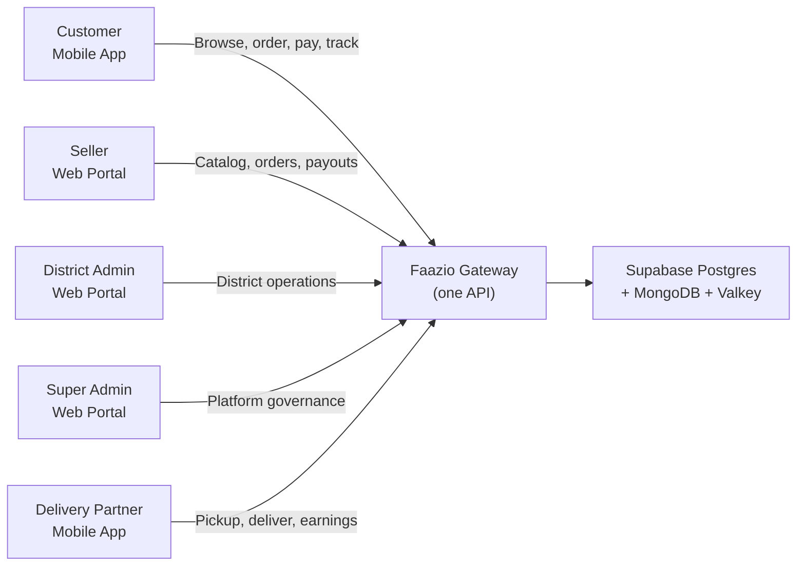

| Surface | Who | Platform | Main job |
|---|---|---|---|
| Customer app | Shoppers | Android + iOS | Discover, order and pay across Mart, Food and Pharma |
| Seller portal | Shop owners/managers | Browser (`/seller/*`) | Manage catalog, orders, inventory, promotions, payments |
| District admin portal | District operators | Browser (`/admin/district/*`) | Run one district: sellers, delivery, orders, coupons |
| Super admin portal | Platform owners | Browser (`/admin/super/*`) | Govern everything: districts, credentials, global catalog |
| Delivery partner app | Riders | Android | Accept jobs, pick up, deliver, track earnings |

---

# 2. Customer mobile app — complete flows

## 2.1 App launch & routing

On a cold start the app decides the first screen from the facts **is the user signed in?**, **has the onboarding been seen?** and **where did the mandatory sign-in funnel stop last time?** Dropping out of the funnel is allowed at the two sign-in steps only; the app is fully usable without an account once a location is set.

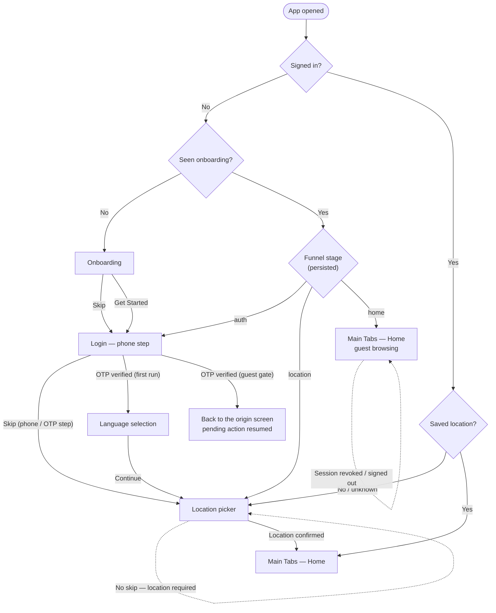

**Notes verified in code**

- While the saved location is still loading, a short splash is shown (with a 3-second safety timeout).
- If a signed-in session is revoked or dies, the app clears local per-user caches and resets to **Main Tabs** as a guest — never a forced login wall.
- If a signed-in chosen address is outside a serviced district, an app-level coverage gate replaces the normal screens. Checkout is still validated server-side.
- The sign-in funnel persists its stage (`useAuthFunnelStore`, key `faazio:funnel:stage`): closing the app at the phone/OTP step reopens the phone-auth screen, and closing it on the location step reopens the picker. A typed-but-unsubmitted name leaves no session, so the next launch starts at the phone step; a guest who confirmed a location lands on **Main Tabs**.
- Location has no escape in either funnel: there is no "Browse without a location" / guest close button.

---

## 2.2 Onboarding

A five-slide welcome carousel shown only on first install (or after onboarding is reset).

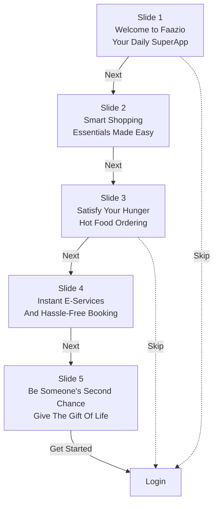

| Screen | Button / control | Action |
|---|---|---|
| Onboarding slides | **Next** | Advance one slide |
| Onboarding slides | **Skip** | Mark onboarding seen → Login (phone step) — the carousel is the only screen the skip short-cuts |
| Final slide | **Get Started** | Mark onboarding seen → Login (sign-in is optional at the phone/OTP step) |
| Onboarding slides | **Back** (where shown) | Return to the previous slide |

---

## 2.3 Sign in (phone + OTP)

Passwordless sign-in in three small steps: mobile number, SMS code, then a name **only when the
account does not already have one**.

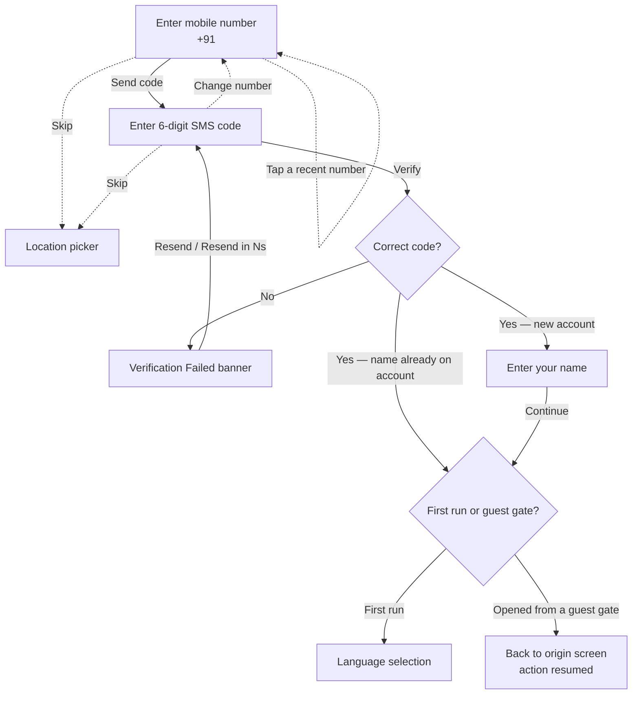

| Screen | Button / control | Action |
|---|---|---|
| Phone step | Country code **+91**, number field + **Send code** | Send SMS OTP |
| Phone step | Recent-number chip | Pre-fill a previously used number |
| OTP step | 6-digit input + **Verify** | Verify code; existing name → sign in, new account → name step |
| Name step (new accounts only) | Name field + **Continue** | Save the name and finish sign-in |
| OTP step | **Resend / Resend in Ns** | Re-send the code after the cooldown |
| Login — phone | **Skip** (top-right) | Clear any pending gated action → Location picker (no guest home; location is required) |
| Login — OTP | **Skip** (top-right) | Abandon verification → Location picker |
| Login — name step | *(no skip)* | A name must be entered to finish sign-in |
| Login — pushed over a screen | **X** (top-left) | Close sign-in and return to the origin screen |
| Login | Back arrow | OTP → phone step; the post-verification name step is not skippable |

> A send or verify that stalls (e.g. a blocked iOS reCAPTCHA sheet) times out after 20 s, shows
> "Verification timed out…" and returns the button to its tappable state — it never spins forever.
> The flow above is unchanged; only this recovery state was added.

---

## 2.4 Language & location

After first-run sign-in the user picks a language, then sets a delivery location. For a signed-in user location is required because stores, fees and delivery time depend on it. A guest who skipped phone auth lands on the picker too, and **must** choose an origin — there is no "Browse without a location" escape; after confirming one they continue to the catalogue as a guest.

### Language selection

| Screen | Button / control | Action |
|---|---|---|
| Language | **English** / **Tamil** option | Select device language |
| Language | **Continue** | Save language → Location picker |

### Location picker & serviceability gate

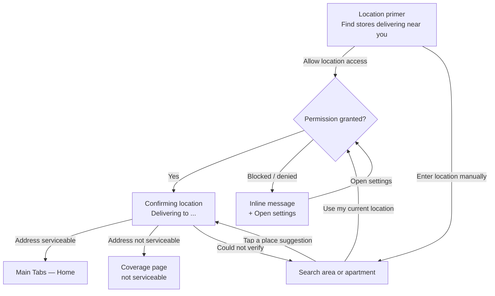

| Screen | Button / control | Action |
|---|---|---|
| Primer | **Allow location access** | Spend the one OS permission prompt |
| Primer | **Enter location manually** | Skip GPS, open the search picker |
| Primer | **Open settings** (on error) | Open device settings to re-enable location |
| Manual picker | Search field | Type an area, street or apartment name |
| Manual picker | **Use my current location** | Request GPS again |
| Manual picker | **Try again** (on error) | Retry the place search |
| Manual picker | Place suggestion row | Resolve address, verify coverage, continue |
| Confirming | **Delivering to …** card | Shows the chosen address while checking coverage |

---

## 2.5 Home hub anatomy

The Home tab is the single entry point to everything. It is a collapsing header plus a server-driven feed.

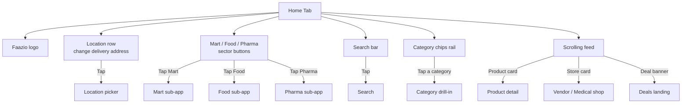

### Home feed sections (server-driven order)

| Section | What the shopper sees | Typical tap target |
|---|---|---|
| Ad banner | Rotating promotional banners | Banner → sub-app |
| Hot brand deals | Brand campaign cards | Campaign → Deals landing |
| Deals of the day | Discounted product rail (unit + **Add**, price, name) | **Add** → Cart; card → Product detail |
| Sponsored rail | Paid placements (ad cards — exempt from the item-card body) | Product → Product detail |
| Most rated dining | Top restaurants | Restaurant → Food profile |
| Recently viewed — Mart / Food / Pharma | Continue-where-you-left-off rails (unit + **Add**, price, name) | **Add** → Cart; card → Product detail |
| Nearby offers | Local offers rail (unit + **Add**, price, name) | **Add** → Cart; card → Product detail |
| Men / Women / Children / Hair & skin | 3-column product grids (unit + **Add** under the image, price, name) | **Add** → Cart; card → Product detail |
| Filter feed | Chip-filtered 3-column product feed (unit + **Add** under the image, price, name) | **Add** → Cart; card → Product detail |

### Home header controls

| Control | Action | Destination |
|---|---|---|
| **Faazio** wordmark | Brand / home anchor | — |
| **Location row** (`address ▾`) | Open location picker | Location |
| Location nudge **Open Settings** | Fix device location permission | Device settings |
| Location nudge **Enter address** | Set address manually | Location |
| Location nudge **×** | Dismiss the nudge | Stay on Home |
| **Mart / Food / Pharma** | Launch a sub-app | Sub-app / Food stack |
| **Search for food, groceries or more…** | Open global search | Search |
| **Category chips** | Open a category page | Category drill-in |
| Bottom tab **Home** | Return to Home | Home |
| Bottom tab **Favourites** | Open favourites | Favourites |
| Bottom tab **Cart** (badge = item count) | Open the cart | Cart |
| Bottom tab **You** | Open account | My Account |
| Raised **Home shortcut** (on other tabs) | Jump back to Home | Home |

---

## 2.6 The three sub-apps (Mart / Food / Pharma)

Each sub-app has its own look and catalog but shares the cart, checkout and account.

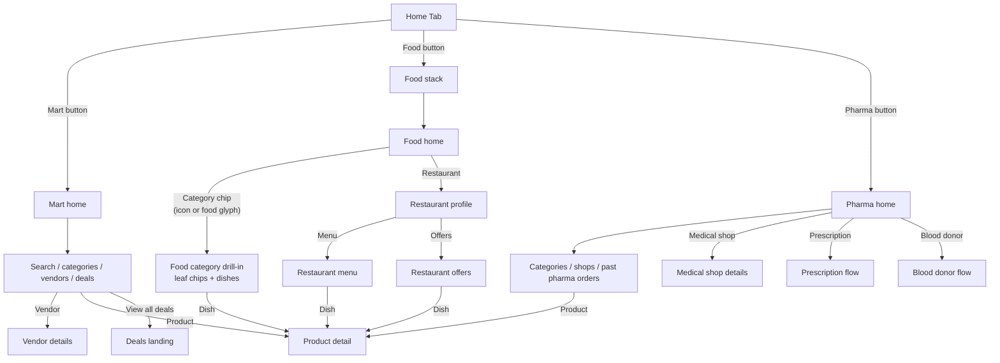

### Sub-app entry points

| Surface | Primary controls | Leads to |
|---|---|---|
| **Mart** | Search, category tabs, vendor rail, deals rail, product cards, add-to-bag | Vendor details, Deals landing, Product detail, Cart |
| **Food** | Search, cuisine/category rail, restaurant cards, menu, offers | Restaurant profile/menu/offers, Product detail, restaurant-scoped Cart |
| **Pharma** | Category chips, shop list, previous pharma orders, **Prescription**, **Blood donor** | Medical shop, Prescription flow, Blood donor, Product detail |

---

## 2.7 Discovery — categories, stores, products, search

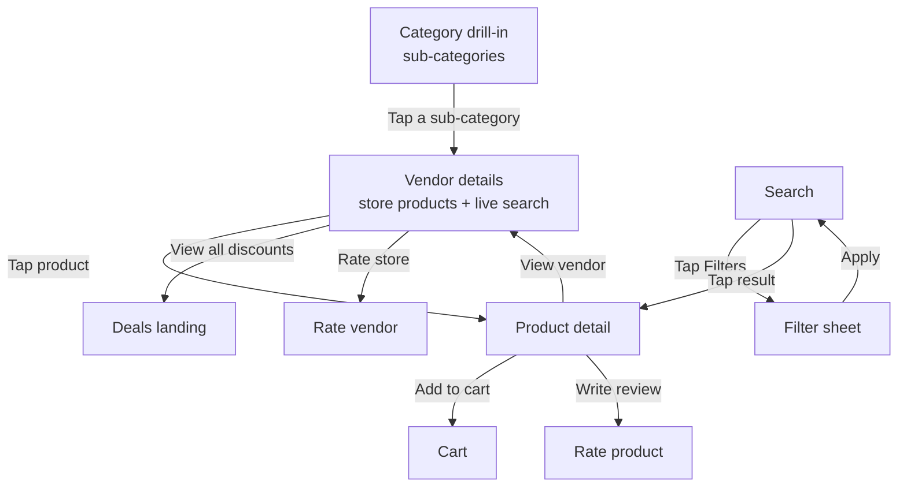

### Category drill-in

| Control | Action | Destination |
|---|---|---|
| Sub-category row | Open that sub-category's stores | Vendor details (pre-filtered) |

### Food category rail & drill-in

| Control | Action | Destination |
|---|---|---|
| Food home category chip (icon or rounded food glyph) | Show that category's leaf sub-categories + matching dishes | Food category drill-in |
| Leaf sub-category pill | Re-filter the dish results on the page | Same screen |
| Dish card **Add** → **− qty +** | Add or change quantity | Cart updated |
| Dish card | Open the dish | Product detail |

### Vendor / store details

| Control | Action | Destination |
|---|---|---|
| Search field | Filter this store's products live | Same screen |
| Product card | Open product | Product detail |
| **View All** (discounts) | Open all discounted items | Deals landing |
| **Rate** store | Open rating form | Rate vendor |

### Product detail

| Control | Action | Destination |
|---|---|---|
| Image gallery | Switch photos | Same screen |
| Variant option | Choose size/pack | Same screen |
| **Add** pill → **− qty +** | Add or change quantity (cross-fades in place) | Cart updated |
| Heart icon | Add / remove favourite | Favourites |
| **Write review** (eligible buyers) | Review form | Rate product |
| **View vendor** | Open the store | Vendor details |
| **Upload prescription** (pharma) | Start prescription flow | Prescription flow |
| Cart icon | Open cart | Cart |

### Search & filters

| Control | Action |
|---|---|
| Search field | Type query, show live results |
| **Filters** | Open sort + facet sheet |
| Sort options | Relevance, Price low→high, Price high→low, Rating |
| Facet chips | Narrow by category/price/rating |
| **Clear all** | Reset staged filters |
| **Apply (N)** | Commit N selected filters |
| Result row | Open product/restaurant |

---

## 2.8 Cart & checkout

The cart is a single wizard used from any sub-app and from the Cart tab. The real step order in code is **BAG → PAYMENT → (payment status / failed) → RECEIPT**.

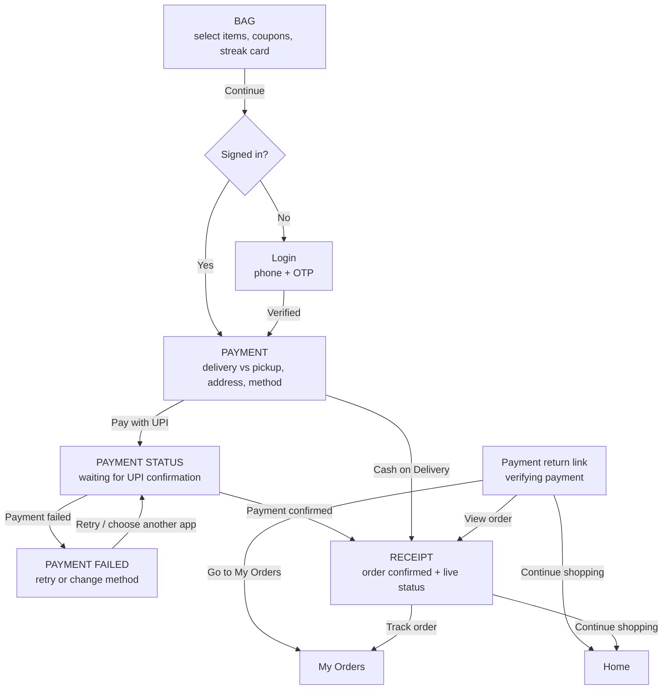

### Step 1 — BAG

| Control | Action |
|---|---|
| Item checkboxes | Include / exclude items from this payment |
| Quantity **+ / −** | Change quantity |
| Delete item | Remove a line |
| Category tabs | Filter cart lines by Mart / Food / Pharma |
| **Coupons** / coupon row | Open coupon sheet, apply a code |
| Streak card | Apply the streak discount |
| **Clear cart** | Empty the cart (scoped to a restaurant when opened there) |
| **Continue** | Guest: open Login, then resume at Payment. Signed in: go to Payment (disabled until items are selected) |

### Step 2 — PAYMENT (Payment Options)

| Control | Action |
|---|---|
| **Delivery / Pickup** toggle | Switch fulfilment mode |
| Address card | Review / change the delivery address |
| Detected **UPI app** row | Pay with that UPI app |
| **Cash / UPI on Delivery** row | Choose pay-on-delivery |
| Coins control | Redeem FaazioCoins |
| **Pay ₹X** | Place the order with the chosen method |
| Back arrow | Return to BAG |
| Distance warning **Continue** | Confirm delivery to a different area |

### Step 3 — payment status and receipt

| Screen | Control | Action |
|---|---|---|
| Payment status | Status animation | Waits for the UPI app result |
| Payment failed | **Retry** / choose another app | Re-attempt payment |
| Receipt | Live status steps | Shows packing → pickup → delivery |
| Receipt | **Track order** | Open My Orders |
| Receipt | **Continue shopping** | Back to Home |
| Payment return link | **View order** / **Verify again** / **Go to My Orders** / **Continue shopping** | Reconciles the real payment status with the server |

> **Payment methods supported:** UPI apps detected on the device and Cash / UPI on Delivery. Cards, net-banking and wallets are intentionally not offered.

---

## 2.9 Orders, tracking, rating & feedback

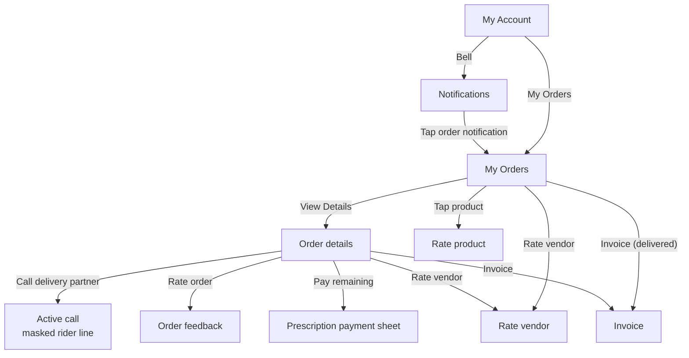

### My Orders

| Control | Action |
|---|---|
| Status filter sheet | All Orders / Processing / Shipped / Delivered / Cancelled |
| App rail | All / Mart / Food / Pharma (with counts) |
| Sort / Filters | Re-order the list |
| **View Details >** | Open order details |
| **Invoice** (delivered) | Download the invoice |
| **Rate vendor** | Open the vendor rating form |
| Bell icon | Open Notifications |

### Order details

| Control | Action |
|---|---|
| **Call delivery partner** | Start a masked call (number never shared) |
| **Rate vendor** | Vendor rating form |
| **Rate your order** | Order feedback form |
| **Invoice** | Fetch/download the invoice |
| **Pay remaining / Pay** | Open the prescription payment sheet |
| Contact support / Request cancellation | Opens a pre-filled email |

### Rating & feedback forms

| Screen | Controls |
|---|---|
| Rate vendor | Star rating + comment + **Submit** |
| Rate product | Star rating + comment + **Submit** |
| Order feedback | Star rating + comment + **Submit feedback** / **Update feedback** |

---

## 2.10 Favourites

> Guests: the Favourites tab (and every heart button) opens **Login**; the page is available after sign-in.

| Control | Action |
|---|---|
| Tabs **All / Mart / Food / Pharma** | Filter favourites by surface |
| Sort menu | Relevance, Price low→high, Price high→low, Rating |
| Heart on a card | Remove from favourites |
| Product card | Open Product detail |
| Back arrow | Return to Home / Account |

> Empty state: "Tap the heart icon on any product across Mart, Food, or Pharma…".

---

## 2.11 FaazioCoins & rewards

> Guests do not see the rewards entry point; the guest account page shows a sign-in card instead.

| Control | Action |
|---|---|
| Coins balance card (**How FaazioCoins work**) | Open the explainer sheet |
| Streak strip | Shows progress across the streak target |
| Discount card | Unlocked after a full streak |
| Ledger row | Shows earned / redeemed coins |

Rules shown to the user: earn coins per spend, redeem in whole rupees at checkout, streak-based discount card.

---

## 2.12 Notifications

| Control | Action |
|---|---|
| Notification row | Open the related order in My Orders / Order details |
| Seller document request row | Open **Sell with us** so the applicant can upload the requested document |
| Back arrow | Return |

The inbox is the durable notification outbox — the same events that power order and promo updates.
A `SELLER_DOC_REQUEST` push tap also deep-links straight to **Sell with us** (not the inbox).

---

## 2.13 Profile & settings

"**My Account**" is built from a server-driven menu. The tree below reflects the signed-in catalog. A guest sees a **Sign in to Faazio** card plus **Orders**, **Favourites** and **FaazioCoins** rows; tapping any of them opens Login and resumes at that screen after sign-in. Preferences (Language) stays available.

The page opens on a burgundy-and-gold hero band (artwork backdrop): a back button and the bell on the top row, then the identity block (avatar initial, name capped at 22 characters with a trailing ellipsis, phone/email, and the white **Edit** pill pinned to the right edge of the row — it opens My Profile) and the **discount-streak card** — gold ticket art, 7 flames with the milestone percentages under the 6th (`5%`) and 7th (`10%`) flame, the `n/7` counter, the reward headline (the unlocked milestone, or the next one while climbing), the FaazioCoins balance chip (opens FaazioRewards) and the **Order now** pill (returns to the Home tab). Everything below the band is the usual light settings canvas. The band carries no "My Account" title; the name is the band's heading. Guests see no identity block, so no Edit pill.

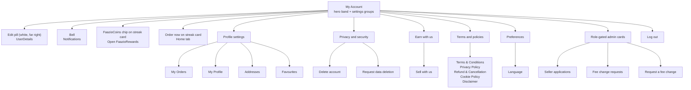

| Group | Row | Tap result |
|---|---|---|
| Profile settings | **My Orders** | My Orders |
| Profile settings | **My Profile** | User details |
| Profile settings | **Addresses** | Saved addresses |
| Profile settings | **Favourites** | Favourites |
| Privacy and security | **Delete account** | Delete account flow |
| Privacy and security | **Request data deletion** | Data-deletion selection flow |
| Earn with us | **Sell with us** | Seller onboarding wizard |
| Terms and policies | Any legal row | Opens the published page on faazio.com |
| Preferences | **Language** | Language screen |
| Admin (district/super) | **Seller applications** | Seller request queue |
| Admin (district/super) | **Fee change requests** | Fee-request review queue |
| Seller role | **Request a fee change** | Platform-fee request form |
| — | **Log out** | Confirm dialog → guest browsing (Main Tabs) |

### Sub-screens

| Screen | Key controls |
|---|---|
| **My Profile** | Profile rows (name, email, phone, security) with edit / retry |
| **Addresses** | Address cards: **Deliver here**, **Edit**, **Delete**; tag **Home / Work / Other**; map pin; default toggle; **Add/Save** |
| **Language** | English / Tamil + Save |
| **Delete account** | Multi-step confirmation → delete |
| **Request data deletion** | Select data categories → submit request |
| **FaazioRewards** | Coins, streak, discount card, ledger, explainer |

---

## 2.14 Pharmacy prescription flow

Full-screen prescription capture that returns a validated order to a chosen pharmacy.

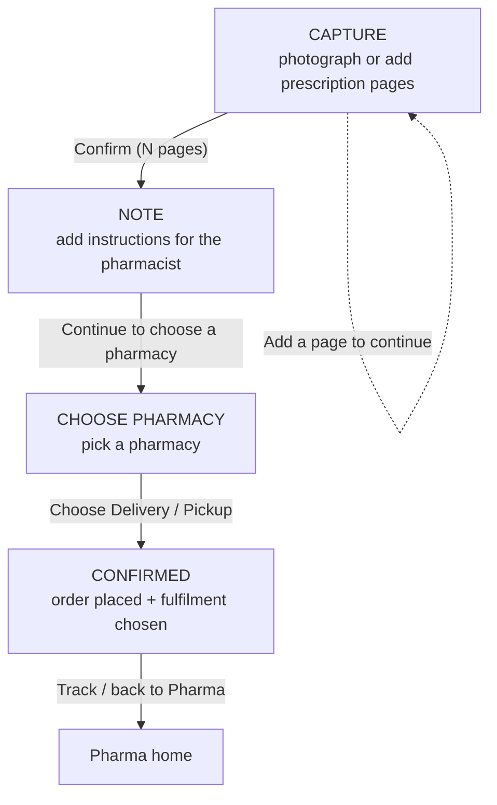

| Step | Controls |
|---|---|
| Capture | Camera capture, **Choose photos from gallery**, **Confirm (N)** |
| Note | Note field, **Continue to choose a pharmacy** |
| Pharmacy | Pharmacy selection, **Delivery** or **Pickup** in the fulfilment sheet |
| Confirmed | Confirmation view; pay/fulfilment follows the normal order path |

---

## 2.15 Blood donor flow

A five-step registration wizard followed by a donor dashboard and an "Ask Blood" search.

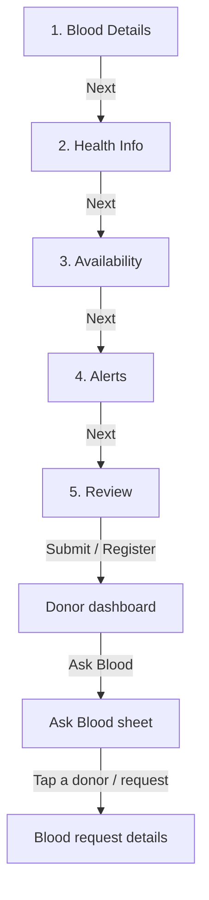

| Step | What is collected |
|---|---|
| Blood Details | Blood group + basic details |
| Health Info | Age range, weight, eligibility questions |
| Availability | Donation type and preferred location |
| Alerts | Who may notify the donor |
| Review | Consent + submit |

| Control | Action |
|---|---|
| **Ask Blood** floating button | Search for matching donors / raise a request |
| Donor result row | Open donor profile |
| Request row | Open blood request description |

---

## 2.16 Sell with us (mobile seller registration)

The customer app also contains the seller application wizard. On approval the applicant is directed to the seller partner app / web portal.

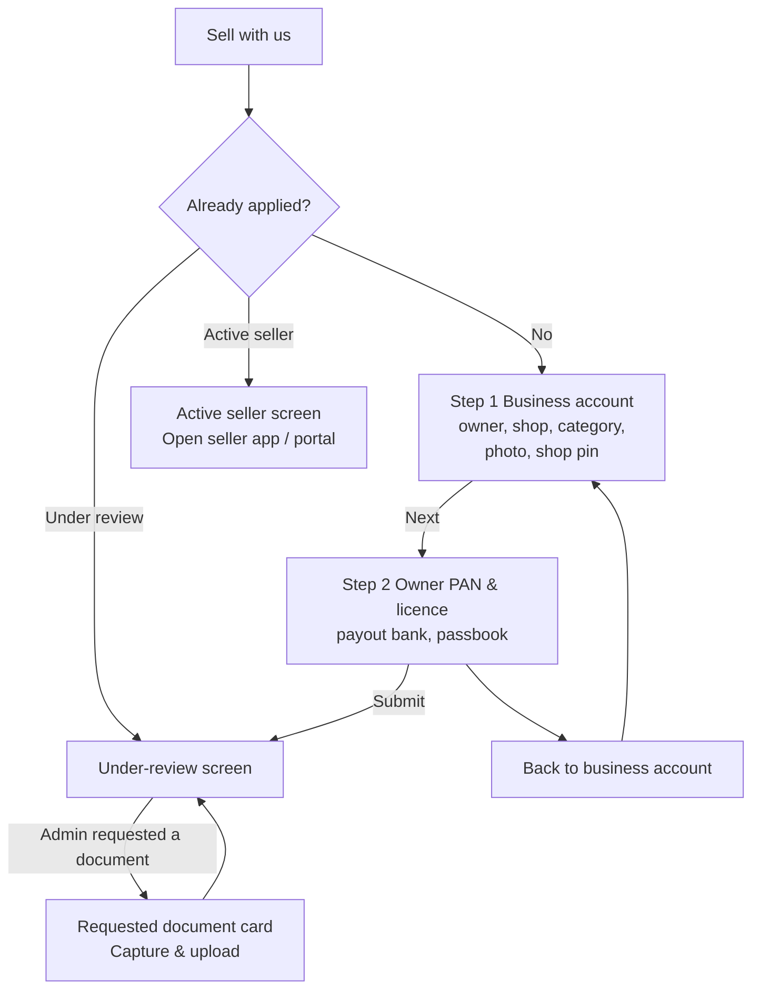

| Area | Controls |
|---|---|
| Business identity | Business name, owner/contact, GSTIN (optional), phone |
| KYC | Passbook/document upload |
| Payout | Bank account details |
| Shops | One card per shop: category, address, FSSAI / drug licence, photos (up to 5) |
| Shop number | `+91` as plain inline text at the start of the field (no separate box) + 10 national digits (digits only, capped at 10); label left-aligned like every other field; with a **Same as owner number** tick below it: ticked copies the owner number and keeps them in step, with the field read-only |
| Shop location | **Pin your shop** full-screen map: tap the map / drag the pin onto the shop door, search the address, or **Use my current location**; sets state, district and the customer-visible map position |
| Submit | **Back to business account** returns to step 1; the large **Submit** button is always enabled — if fields are missing it shows a red inline message naming what to fill in (no OTP signature step and no agreement tick-boxes) |
| Post-submit | Under-review status; on approval open the seller app / portal |
| Requested document | If an admin taps **Request** on a KYC row, this screen shows "Faazio has requested you to upload your <document>" with **Capture & upload** — the applicant uploads and the request clears |

---

## 2.17 Calling the delivery partner

| Control | Action |
|---|---|
| **Call delivery partner** (Order details) | Open the full-screen **Active call** surface |
| Active call | Masked voice call — the phone number is never shown to either side |

---

## 2.18 Customer end-to-end journey

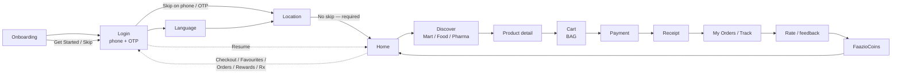

---

# 3. Partner Web Portal — complete flows

The portal is one Next.js app with three role-based consoles. The first screen is always `/login`; after sign-in the user is routed to the console that matches their role.

## 3.1 Role sign-in & routing

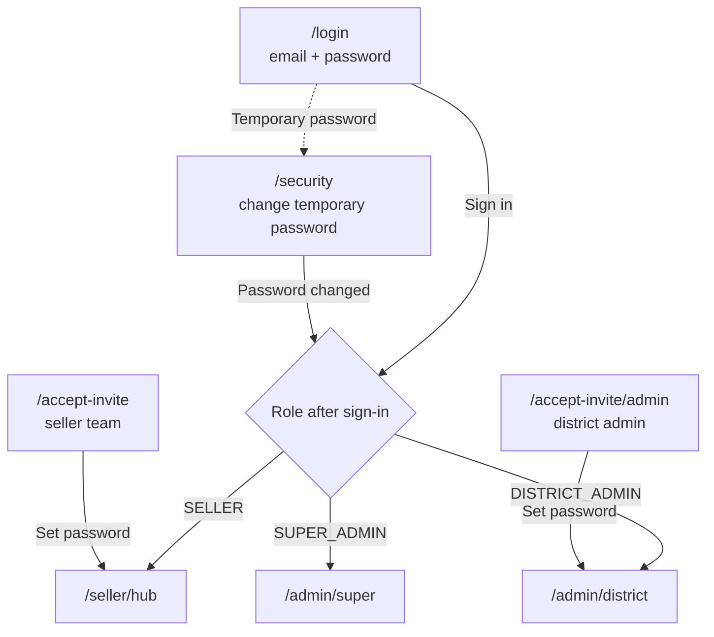

| Screen | Control | Action |
|---|---|---|
| `/login` | Email, Password, **Show/Hide** | Enter credentials |
| `/login` | **Sign in** | Authenticate and route by role |
| `/login` | Remember me | Persist the session |
| `/security` | New password + confirm | Replace a temporary password |
| `/accept-invite` | Set password | Activate a seller-team account |
| `/accept-invite/admin` | Set password | Activate a district-admin account |

> A seller attempting to use the native seller app with a non-seller role sees the same generic error as a wrong password (no role disclosure).

## 3.2 Seller console navigation

The seller sidebar changes slightly by shop sector: **Food** shops get a **Menu** editor; **Mart / Pharma** shops get **Offers** instead.

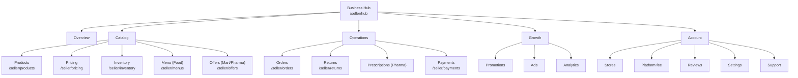

| Group | Page | Purpose |
|---|---|---|
| Overview | **Business Hub** | Daily snapshot: orders, sales, tasks, shortcuts |
| Catalog | **Products** | Product list, add/edit, trash |
| Catalog | **Pricing** | Prices / price updates |
| Catalog | **Inventory** | Stock levels |
| Catalog | **Menu** (Food) | Dish sections, sub-categories, publish |
| Catalog | **Offers** (Mart/Pharma) | Product-first offers surface |
| Operations | **Orders** | Live order board + order detail |
| Operations | **Returns** | Cancelled / returned orders |
| Operations | **Prescriptions** (Pharma) | Prescription queue |
| Operations | **Payments** | Payouts / settlements |
| Growth | **Promotions** | Campaigns / discounts |
| Growth | **Ads** | Shop-page ads |
| Growth | **Analytics** | Sales analytics |
| Account | **Stores** | Outlet list, add a vendor |
| Account | **Platform fee** | Request a fee change + history |
| Account | **Reviews** | Customer reviews / replies |
| Account | **Settings** | Profile, bank, notifications, sub-users, security |
| Account | **Support** | Help centre |

### Additional seller routes (reached from the pages above)

| Route | Reached from |
|---|---|
| `/seller/orders/[id]` | Orders board → order row |
| `/seller/order-history` | Orders / dashboard |
| `/seller/products/new` | Products → **Add product** |
| `/seller/products/[id]/edit` | Products → edit |
| `/seller/products/trash` | Products → trash |
| `/seller/fee-history` | Platform fee → history |
| `/seller/notifications` | Header bell |
| `/seller/outlet-info` | Stores → outlet |
| `/seller/restaurant-status` | Orders / dashboard (rush control) |
| `/seller/rush-hour` | Dashboard / restaurant status |
| `/seller/onboarding` | Stores → **Add a vendor** |
| `/seller/explore` | Business hub explore shortcuts |

## 3.3 Seller order lifecycle

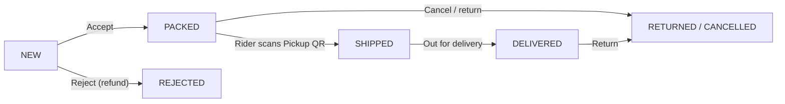

| Screen | Control | Action |
|---|---|---|
| Orders board | Tabs by status | Filter the board |
| Orders board | **Accept** | NEW → PACKED, triggers dispatch |
| Orders board | **Reject** | Choose a reason → NEW → REJECTED, refunds |
| Orders board | **Pickup QR** | Mint a short-lived QR for the rider |
| Orders board | **Print** | Print the order/packing slip |
| Order detail | Status actions | Advance PACKED → SHIPPED → DELIVERED |
| Cancelled & returns | Row action | Inspect / advance a return |

> Accepting an unpaid order is blocked (`payment_pending`). The pickup QR only works once a rider is allocated.

## 3.4 Seller catalog workflows

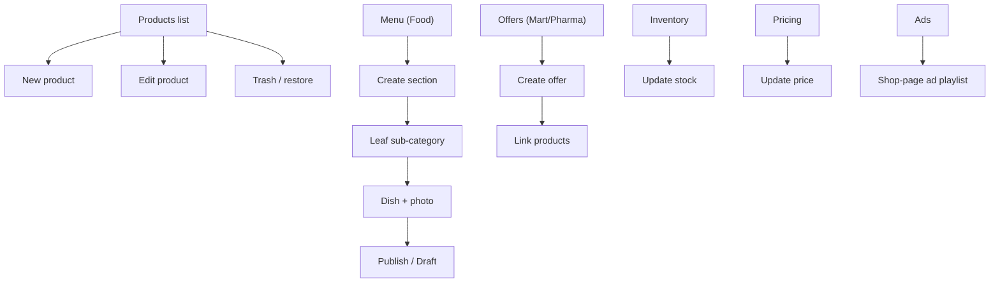

| Workflow | Steps / controls |
|---|---|
| Add product | Products → **New** → fill details → upload media → Save |
| Edit product | Products → row → **Edit** → save |
| Trash | Products → **Trash** → restore or delete forever |
| Menu creation (Food) | Menu → section → leaf sub-category → dish + photo → **Publish / Draft** |
| Add-ons | Menu/dish → add-on → create / link / review |
| Offers (Mart/Pharma) | Offers → create → link products → publish |
| Inventory | Inventory → product → update stock |
| Pricing | Pricing → product → update price |
| Ads | Ads → playlist → draft/play/order/target |

## 3.5 District admin console

A district admin runs one district. The sidebar groups reflect the operational focus.

```mermaid
flowchart TD
  D["District Dashboard"]
  D --> OV["Overview"]
  D --> SUP["Supply"]
  D --> GR["Growth"]
  D --> OP["Operations"]

  SUP --> SELL["Sellers"]
  SUP --> INQ["Seller enquiries"]
  SUP --> CUST["Customers"]
  SUP --> RIDER["Delivery partners"]
  SUP --> PRODS["Products"]
  SUP --> LQ["Listing queue"]
  SUP --> AQ["Add-on queue"]
  SUP --> FEE["Fee change requests"]
  SUP --> PA["Pricing audit"]

  GR --> FEST["Festival"]
  GR --> CONTENT["Content"]
  GR --> COUP["Coupons"]

  OP --> ORD["Orders monitor"]
  OP --> ALLOC["Manual allocation"]
  OP --> DPAY["Delivery payouts"]
  OP --> BLOOD["Blood bank"]
  OP --> SUPP["Support"]
  OP --> ANA["Analytics"]
  OP --> AUDIT["Audit log"]
  OP --> SET["Settings"]
```

| Group | Page | Purpose |
|---|---|---|
| Overview | **Dashboard** | District GMV, sector mix, alerts, campaigns |
| Supply | **Sellers** | Seller roster / review (`/sellers/[id]`) |
| Supply | **Seller enquiries** | Incoming seller interest |
| Supply | **Customers** | Customer lookup |
| Supply | **Delivery partners** | Rider roster |
| Supply | **Products** | District product catalog |
| Supply | **Listing queue** | Approve new listings |
| Supply | **Add-on queue** | Approve add-ons |
| Supply | **Fee change requests** | Approve platform-fee changes |
| Supply | **Pricing audit** | Flag pricing issues |
| Growth | **Festival** | Festival campaigns |
| Growth | **Content** | District content |
| Growth | **Coupons** | District coupons |
| Operations | **Orders monitor** | Live district orders |
| Operations | **Manual allocation** | Assign riders manually |
| Operations | **Delivery payouts** | Rider payouts |
| Operations | **Blood bank** | Blood donor operations |
| Operations | **Support** | Support queue |
| Operations | **Analytics** | District analytics |
| Operations | **Audit log** | Change history |
| Operations | **Settings** | District settings |

### 3.5.1 Seller application review (`/admin/district/sellers/[id]`)

```mermaid
flowchart TD
  R["District admin → Sellers → open application"] --> D{"Review"}
  D -->|"Verify on each KYC row"| VD["Document verified"]
  D -->|"Edit (Registered details)"| ED["Correct GSTIN/PAN/address and payout bank name / IFSC / holder"]
  ED --> RV["Compliance re-runs on save"]
  D -->|"Verify KYC & activate"| CK{"Compliance FAILED?"}
  CK -->|"Yes"| BLK["Activation blocked + reason shown on Decision card"]
  BLK --> ED
  CK -->|"No"| ACT["Seller ACTIVE + one-time login credential"]
  D -->|"Reject"| REJ["REJECTED with reason"]
  D -->|"Suspend"| SUS["SUSPENDED"]
```

| Control | Effect |
|---|---|
| **Verify** (per KYC row) | Verifies that document (`POST /sellers/{id}/verify-doc/{docType}`) |
| **Request** (per KYC row) | Asks the applicant to re-upload that document |
| **Edit** (Registered details) | Corrects GSTIN/PAN/address and the payout bank name, IFSC and account holder; the account number stays masked |
| **Save details** | Saves the profile and, if changed, the payout account; compliance is recomputed immediately |
| **Verify KYC & activate** | Re-runs compliance, then activates and returns the one-time seller login; refused with the reason if a check is still `FAILED` |
| **Reject** / **Suspend** | Rejects (seller can resubmit) or suspends (listings go offline) with a reason |

## 3.6 Super admin console

A super admin governs the whole platform.

```mermaid
flowchart TD
  S["Command Center"]
  S --> OV["Overview"]
  S --> GOV["Governance"]
  S --> SUP["Supply"]
  S --> GR["Growth"]
  S --> OP["Operations"]

  GOV --> DA["District admins"]
  GOV --> CRED["Credentials"]
  GOV --> CFG["App config"]
  GOV --> USERS["Users"]
  GOV --> COV["District coverage"]

  SUP --> SELL["Sellers"]
  SUP --> INQ["Seller enquiries"]
  SUP --> FEE["Fee change requests"]
  SUP --> RIDERS["Delivery partners"]
  SUP --> PRODS["Products"]
  SUP --> GST["GST rates"]
  SUP --> CATS["Categories"]
  SUP --> FMASTER["Food master"]

  GR --> FEST["Festival"]
  GR --> COUP["Coupons"]
  GR --> ADS["Ads"]
  GR --> SDUI["App content (SDUI)"]

  OP --> ANA["Analytics"]
  OP --> ORD["All orders"]
  OP --> ALLOC["Manual allocation"]
  OP --> MPAY["Manual payouts"]
  OP --> DPAY["Delivery payouts"]
  OP --> REW["Rewards"]
  OP --> AUDIT["Audit log"]
  OP --> COVERAGE["Coverage"]
  OP --> SET["Settings"]
```

| Group | Page | Purpose |
|---|---|---|
| Overview | **Command center** | Global GMV, sector mix, district matrix, alerts |
| Governance | **District admins** | Roster + invite hand-over |
| Governance | **Credentials** | Seller credential hand-over |
| Governance | **App config** | Global app configuration |
| Governance | **Users** | Find any customer |
| Governance | **District coverage** | Create/edit districts (`/districts/[code]`) |
| Supply | **Sellers** | Global seller directory |
| Supply | **Seller enquiries** | Global enquiries |
| Supply | **Fee change requests** | Global fee approvals |
| Supply | **Delivery partners** | Global rider directory |
| Supply | **Products** | Global catalog + seller requests |
| Supply | **GST rates** | Tax slab master |
| Supply | **Categories** | Taxonomy + header labels |
| Supply | **Food master** | Atomic cuisine taxonomy, carousel map, store rules, sample dishes |
| Growth | **Festival / Coupons / Ads** | Global campaigns |
| Growth | **App content (SDUI)** | Server-driven UI content |
| Operations | **Analytics** | Platform analytics |
| Operations | **All orders** | Every order (`/orders/[id]`) |
| Operations | **Manual allocation** | Cross-district rider assignment |
| Operations | **Manual payouts / Delivery payouts** | Payout operations |
| Operations | **Rewards** | FaazioCoins configuration |
| Operations | **Audit log / Coverage / Settings** | Governance + config |

## 3.7 Invite acceptance

```mermaid
flowchart TD
  MAIL["Invite link"] --> SELLINV["/accept-invite"]
  MAIL --> ADMININV["/accept-invite/admin"]
  SELLINV --> SETPW["Set password"]
  ADMININV --> SETPWA["Set password"]
  SETPW --> HUB["Seller console"]
  SETPWA --> DIST["District admin console"]
```

| Link | Who | After setting password |
|---|---|---|
| `/accept-invite` | Seller team member | Seller console (`/seller/hub`) |
| `/accept-invite/admin` | District admin | District console (`/admin/district`) |

## 3.8 Portal end-to-end journey

```mermaid
flowchart LR
  L["Login"] --> R{"Role"}
  R -->|"Seller"| HUB["Business Hub"]
  HUB --> BOARD["Orders board"]
  BOARD --> ACC["Accept / Pack / Pickup QR"]
  ACC --> SHIP["Dispatch + track"]
  HUB --> CAT["Catalog / pricing / inventory"]
  HUB --> PAY["Payments / fee request"]
  R -->|"District admin"| DIST["District dashboard"]
  DIST --> DSELL["Review sellers / queues"]
  DIST --> DORD["Orders monitor / allocation"]
  R -->|"Super admin"| SUPER["Command center"]
  SUPER --> GOV["Districts / credentials / coverage"]
  SUPER --> GLOBAL["Global catalog / GST / content"]
```

---

# 4. Cross-surface order lifecycle

One order touches all surfaces. This is the single most useful diagram to share with a client because it shows how the customer's tap becomes a seller task and a delivery job.

```mermaid
flowchart LR
  C1["Customer<br/>adds to cart"] --> C2["Customer<br/>pays / COD"]
  C2 --> G["Gateway creates order"]
  G --> S1["Seller sees NEW order"]
  S1 -->|"Accept"| S2["PACKED"]
  S2 -->|"Pickup QR scanned"| D1["Rider picks up"]
  D1 --> S3["SHIPPED"]
  S3 --> D2["Rider delivers"]
  D2 --> C3["Customer sees DELIVERED<br/>receipt + invoice"]
  C3 --> C4["Customer rates / feedback"]
  S1 -->|"Reject"| X["REJECTED + refund"]
  S2 --> A["Admin monitors order / payouts"]
  D1 --> A
```

| Stage | Customer sees | Seller sees | Admin sees |
|---|---|---|---|
| Order placed | Payment confirmation / receipt | New order on board | Order monitor |
| Accepted | Live status updates | PACKED + Pickup QR | Live order state |
| Picked up | "Out for delivery" | SHIPPED | Delivery job |
| Delivered | Receipt + invoice | DELIVERED | Completed order |
| After delivery | Rating / feedback / coins | Review in Reviews page | Audit + analytics |
| Exception | Refund / support | Reject / return | Refund / audit |

---

# 5. Quick-reference button inventory

## 5.1 Customer app — every major screen

| # | Screen | Buttons / controls you can tap |
|---|---|---|
| 1 | Onboarding | Next, Skip (→ Login phone step), Get Started (→ Login) |
| 2 | Login — phone | +91, number field, Send code, recent-number chip, **Skip** (→ Location), X (when pushed) |
| 3 | Login — OTP | 6-digit input, Verify, Resend, **Skip** (→ Location) |
| 4 | Login — name (new accounts only) | Name field, Continue |
| 5 | Language | English, Tamil, Continue |
| 6 | Location primer | Allow location access, Enter location manually, Open settings |
| 7 | Location search | Search field, Use my current location, suggestion rows |
| 8 | Home | Location row, Mart, Food, Pharma, Search bar, category chips, product/store/deal cards, bottom tabs |
| 9 | Category drill-in | Sub-category rows |
| 10 | Vendor details | Search field, product cards, View All, Rate |
| 11 | Product detail | Gallery, variants, Add to cart / + / −, Heart, Write review, View vendor, Upload prescription |
| 12 | Search | Search field, Filters, sort options, facet chips, Clear all, Apply |
| 13 | Cart — BAG | Item checkboxes, + / −, delete, category tabs, coupons, streak card, Clear cart, Continue |
| 14 | Payment options | Delivery/Pickup, address card, UPI app, Cash on Delivery, coins, Pay ₹X, Back |
| 15 | Payment status | (waiting state) |
| 16 | Payment failed | Retry, choose another app |
| 17 | Receipt | Track order, Continue shopping |
| 18 | Payment return | View order, Verify again, Go to My Orders, Continue shopping |
| 19 | My Orders | Status sheet, app rail, sort/filter, View Details, Invoice, Rate vendor, bell |
| 20 | Order details | Call delivery partner, Rate vendor, Rate order, Invoice, Pay remaining, Support |
| 21 | Rate vendor | Stars, comment, Submit |
| 22 | Rate product | Stars, comment, Submit |
| 23 | Order feedback | Stars, comment, Submit / Update feedback |
| 24 | Favourites | All/Mart/Food/Pharma, sort, heart, product |
| 25 | FaazioRewards | How FaazioCoins work, ledger, discount card |
| 26 | Notifications | Notification rows |
| 27 | My Account | Burgundy hero band (no title — name is the heading, white Edit pill at the far right of the identity row, bell, identity, discount-streak card with Order now), all menu rows, Log out (guest: Sign in card + gated Orders/Favourites/Coins rows) |
| 28 | My Profile | Profile rows / edit |
| 29 | Addresses | Deliver here, Edit, Delete, tag, pin, default, Save |
| 30 | Language (profile) | English, Tamil, Save |
| 31 | Delete account | Confirm steps |
| 32 | Request data deletion | Data categories, Submit |
| 33 | Prescription | Camera, Choose photos, Confirm (N), note, Continue, Delivery/Pickup |
| 34 | Blood donor | Next through 5 steps, Submit, Ask Blood |
| 35 | Sell with us | Step 1 fields + **Next**, step 2 fields + **Back to business account**, **Submit** |
| 36 | Active call | End call |

## 5.2 Seller portal — every sidebar page

| Page | Primary actions |
|---|---|
| Business Hub | Date range, quick shortcuts, open reviews, open order |
| Products | Add, edit, trash, restore |
| Pricing | Update price |
| Inventory | Update stock |
| Menu (Food) | Section, leaf sub-category, dish, photo, Publish/Draft |
| Offers (Mart/Pharma) | Create offer, link products |
| Orders | Accept, Reject, Pickup QR, Print, advance status |
| Returns | Inspect / advance return |
| Prescriptions | Review prescription, quote |
| Payments | View payouts |
| Promotions | Create campaign |
| Ads | Playlist draft/play/order/target |
| Analytics | Date-range reporting |
| Stores | Add a vendor, open outlet |
| Platform fee | Request change, history |
| Reviews | Reply to review |
| Settings | Profile, bank, notifications, sub-users, security |
| Support | Help centre |

## 5.3 District admin — every sidebar page

Dashboard, Sellers, Seller enquiries, Customers, Delivery partners, Products, Listing queue, Add-on queue, Fee change requests, Pricing audit, Festival, Content, Coupons, Orders monitor, Manual allocation, Delivery payouts, Blood bank, Support, Analytics, Audit log, Settings.

## 5.4 Super admin — every sidebar page

Command center, District admins, Credentials, App config, Users, District coverage, Sellers, Seller enquiries, Fee change requests, Delivery partners, Products, GST rates, Categories, Food master, Festival, Coupons, Ads, App content (SDUI), Analytics, All orders, Manual allocation, Manual payouts, Delivery payouts, Rewards, Audit log, Coverage, Settings.

---

# 6. Empty / error / offline states

A complete workflow includes what happens when things go wrong. These are the user-visible states verified in code.

| Situation | What the user sees | Recovery control |
|---|---|---|
| No connection (Home feed) | "Could not load your feed" | **Try again** |
| Empty Home feed | "Nothing here yet / Check back soon" | Pull to refresh |
| Account menu fails | "Couldn't load account settings" | **Try again** |
| Location denied/blocked | Inline reason text | **Open settings** / **Enter manually** |
| Location not serviceable | Coverage gate page | Change address |
| OTP wrong | "Verification Failed" banner | **Resend** |
| OTP send/verify times out (stuck iOS reCAPTCHA) | "Verification timed out…" under Send code / in the OTP banner | **Send code** / **Resend** |
| Coupon invalid/expired | Inline coupon error | Change/remove coupon |
| Payment pending | Payment status screen | Wait / check My Orders |
| Payment failed | Payment failed screen | **Retry** |
| Distance mismatch | "You're in a different area… Continue?" | **Continue** / Cancel |
| Prescription submit fails | Inline error, stays on step | Retry |
| Seller order unpaid | Accept blocked (`payment_pending`) | Wait for payment |
| Portal session expired | 401 redirect to `/login` | Sign in again |
| Portal not configured | Diagnostic message | Retry / contact support |
| Favourites empty | "Tap the heart icon on any product…" | Browse |

> **Design rule:** while online, the app never substitutes fixture/demo data for a failed server read. Empty and error states are honest.

---

# 7. Appendix — source file map

Use this map if a flow changes and the diagram needs to be updated.

| Area | Files |
|---|---|
| Customer navigation | `client/mobile/src/navigation/AppNavigator.tsx`, `MainTabs.tsx`, `types.ts`, `FoodStack.tsx` |
| Onboarding / auth | `features/onboarding/*`, `features/auth/LoginScreen.tsx`, `features/auth/LocationScreen.tsx` |
| Home | `features/home/HomeTabScreen.tsx`, `HomeView.tsx`, `sections/*` |
| Mart / Food / Pharma | `features/ecommerce/*`, `features/food/*`, `features/pharma/*`, `features/sub-app/*` |
| Discovery | `features/catalog/*`, `features/product/*`, `features/search/*` |
| Cart / checkout | `features/cart/CartView.tsx`, `features/cart/payment/*` |
| Orders | `features/profile/MyOrdersScreen.tsx`, `OrderDetailsScreen.tsx`, `OrderFeedbackScreen.tsx`, `RateVendorScreen.tsx`, `features/product/RateProductScreen.tsx` |
| Profile | `features/profile/AccountView.tsx`, `UserDetailsScreen.tsx`, `SavedAddressesScreen.tsx`, `LanguageScreen.tsx`, `DeleteAccountScreen.tsx`, `RequestDataDeletionScreen.tsx` |
| Rewards / favourites / notifications | `features/rewards/*`, `features/favourites/*`, `features/notifications/*` |
| Pharmacy | `features/pharma/prescription/*`, `features/pharma/blood-donor/*` |
| Seller onboarding (mobile) | `features/seller-onboarding/SellerRegistrationScreen.tsx` |
| Account menu catalog | `data/account/accountNav.ts` (seed source; live from `GET /account-nav`) |
| Web portal nav | `client/web/platform/src/components/layout/nav.ts` |
| Portal routes | `client/web/platform/app/**/page.tsx` (seller, admin/district, admin/super, accept-invite, login) |
| Seller order lifecycle | `client/web/platform/app/seller/orders/*` + `docs/user-interaction-workflow/seller/orders/order-lifecycle.md` |
| Portal auth | `client/web/platform/app/api/auth/portal/*`, `src/lib/portal/*` |

---

## Change log

| Version | Date | Change |
|---|---|---|
| 1.21 | 28 Nov 2026 | Seller review (`/admin/district/sellers/[id]`): added a **3.5.1** flow — the district admin can now correct a bad payout **IFSC**/bank name/account holder from **Registered details → Edit** (account number stays masked). Compliance is re-run on that save and at **Verify KYC & activate**, so a corrected IFSC clears a stale `FAILED` block; the **Decision** card shows the blocking reason. |
| 1.20 | 28 Nov 2026 | Admin notifications console (`/admin/{district,super}/notifications`): added a **Seller activity** feed (new registrations, KYC document uploads, fulfilled document requests) read from the seller tables, each card opening the seller detail. Outbox rows are now clickable (seller detail / order / product destination) and all descriptive copy was removed. |
| 1.19 | 28 Nov 2026 | Seller review: missing KYC documents are now shown as **cards** with a **Request** button (the document-type dropdown and admin-side upload are gone). The `SELLER_DOC_REQUEST` push and in-app notification now deep-link straight to the customer-app **Sell with us** screen so the applicant can upload. |
| 1.18 | 28 Nov 2026 | Seller review: the admin KYC row **Replace** action became **Request** — the admin asks the applicant to re-upload. The customer-app Sell with us screen now shows "Faazio has requested you to upload your <document>" with a **Capture & upload** button that fulfils the request (`sellers.document_requests`, migration `0147`). |
| 1.17 | 28 Nov 2026 | Sell with us: removed every per-question/input description and the bottom security/autosave notes. The step 2 submit button is now a single large **Submit** button that is always enabled — tapping it with missing or invalid fields shows a red inline message naming what to fill in. |
| 1.16 | 28 Nov 2026 | Sell with us: the **Shop number** `+91` is now plain inline text at the start of the field (the separate dial-code box is gone), so the field and its label line up like every other input. |
| 1.15 | 28 Nov 2026 | Sell with us step 2: the **Signature** block is gone (Send OTP / 6-digit code / Verify / resend countdown / "OTP verified" panel), and the three agreement tick-boxes (Terms of Service, Seller / Partner Agreement, content & IP licence) with their **Read** sheets are gone as well. Submitting the application is the acceptance; the gateway's required consent flags are sent with it. Step 2 now ends on **Back to business account**. |
| 1.14 | 28 Nov 2026 | My Account: the **Edit** pill moved to the far right of the identity row (it used to sit beside the name) and is now white with ink text/icon instead of the gold wash. The decorative crown that occupied that corner was removed. |
| 1.14 | 28 Nov 2026 | Sell with us: the two-step rail (**1 Business account / 2 Licence & payout**), the blue **Partner with Faazio** banner and the whole **Platform fee** question (title, description, rate-card dropdown, summary and retry row) are gone. The wizard now opens straight on the Business account form and step 2 starts at **Owner PAN & licence**; the shop is put on the lowest-commission rate card the gateway publishes, disclosed in the Terms of Service summary the applicant accepts. |
| 1.13 | 28 Nov 2026 | Sell with us: the **Shop number** now uses a fixed **+91** prefix and accepts 10 digits only, with a **Same as owner number** tick below the field that mirrors the owner number (field read-only while ticked, kept in step with later owner edits). |
| 1.12 | 28 Nov 2026 | My Account hero band: the **My Account** title is gone (the account name is the band's heading) and the **Edit** pill now sits directly right of the name, capped at 22 characters with a trailing ellipsis so a long name never crowds it. Top row keeps only the back button and the bell. Guests see no Edit pill (there is no name row for them). |
| 1.11 | 27 Nov 2026 | Sign-in funnel: onboarding **Skip** now opens the phone-auth screen instead of guest Home; **Skip** on the phone and OTP steps advances to the location picker, which has no escape (**Browse without a location** removed). The funnel stage persists across app restarts. Home / Mart header category rail no longer shows a dead **Retry** when the rail is unavailable (401) or the super admin has turned every element off. |
| 1.10 | 27 Nov 2026 | Sell with us: **Pin your shop** now shows a native map with a draggable marker (tap/drag onto the shop), with address search and “use my current location” as fallbacks. Fixed the shop-photo upload returning a gateway 500 for full-resolution phone photos (AVIF conversion now runs on a detached 45 s deadline instead of the 10 s request timeout). |
| 1.9 | 26 Nov 2026 | Customer sign-in reordered to phone → OTP → name. After OTP, an existing account signs straight in with its stored name; only a first-time account is asked for a name (backed by `GET /profile` `hasName`). Skip stays on the phone step; the name step is not skippable. |
| 1.8 | 26 Nov 2026 | Super admin **Supply → Food master** page: read-only atomic cuisine taxonomy (147 rows), carousel → cuisine map (24), store onboarding rules (11) and sample dish templates (15), all from migration `0145`. Seller dish form now shows the picked leaf’s cuisine; Food category drill-in shows a one-line cuisine subtitle. FOOD menus re-mapped off the over-loaded Chicken bucket. |
| 1.7 | 26 Nov 2026 | Every non-ad item card (Mart, Mart home rails, Home grids + rails, Pharma) now shares the unit/price/name body: unit + **Add** on one line under the image, price below, name last. Paid ad cards are exempt. Pharma grid cards now show their price. Also fixed the Add-tap crash (Reanimated easing), and backfilled `unit` on all 822 catalogue rows (0144). |
| 1.6 | 26 Nov 2026 | Food home category rail below the ad banner: FOOD taxonomy roots render as circular chips (server icon or rounded food-glyph fallback) and open a Food category drill-in with leaf pills + dish results. |
| 1.5 | 26 Nov 2026 | 3-column item cards: body reordered to unit (left) + **Add** (right) directly under the image, then price, then item name. The Home 3-up grids and the Daily Essentials grid now mount the card-level Add control (previously tap-to-view only). |
| 1.4 | 26 Nov 2026 | Mart product cards: removed the badge/tag labels (Best Seller, % OFF, price-claim notes); the paid-placement AD disclosure stays. Also fixed the Mart floating nav leaving a blank band behind it when auto-hidden. No navigation/button changes. |
| 1.3 | 26 Nov 2026 | Mart item cards: product ratings removed from every Mart card, item names now 2 lines, and the Daily Essentials "View All" page is a 3-column tap-to-view Home-style grid (no rating, no card-level add). Navigation/buttons unchanged. |
| 1.2 | 26 Nov 2026 | OTP send/verify hard timeout (20 s) — adds the "Verification timed out…" recovery state; no screen/button changes |
| 1.1 | 26 Nov 2026 | Guest browsing (no forced login): Main Tabs as the signed-out default, Skip on onboarding/login, auth gates at checkout/favourites/rewards/prescription, guest cart merge on sign-in |
| 1.0 | 26 Nov 2026 | First complete visual workflow guide for customer app + partner web portal |

> This document is a living reference. If a screen, route, tab or button changes, update the matching diagram and the quick-reference table in the same change.
